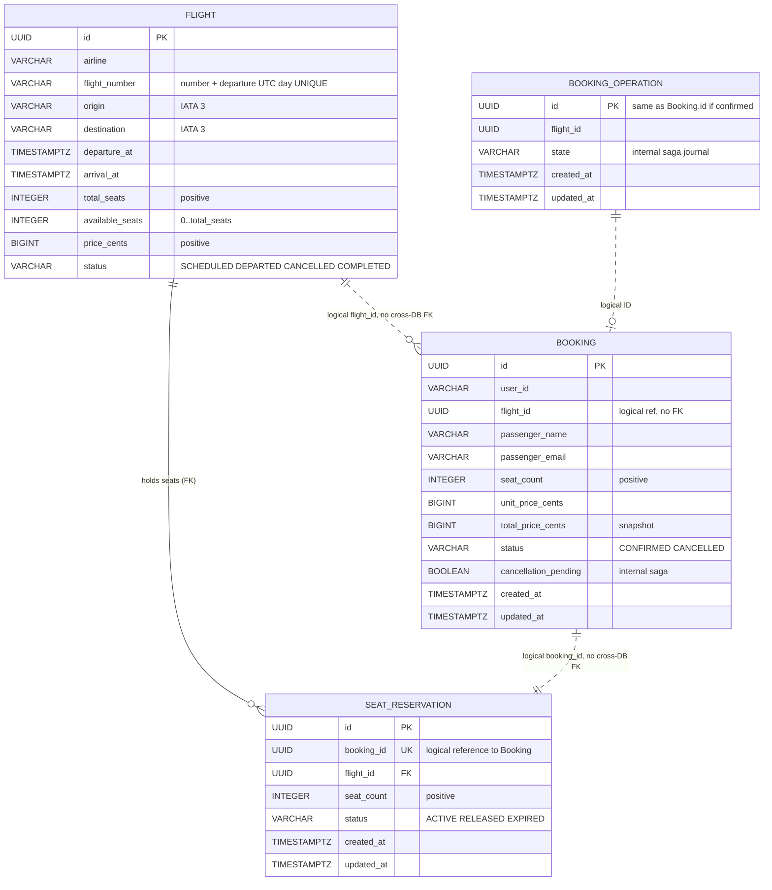

# ER-диаграмма (3NF; Mermaid)

**Физическое размещение:** FLIGHT и SEAT_RESERVATION принадлежат только БД `flights`; BOOKING и BOOKING_OPERATION — только БД `bookings`. Стрелки с пунктиром обозначают логические связи без межбазовых внешних ключей. Связь SeatReservation.booking_id уникальна: для одного бронирования максимум одна запись резерва.

**3NF:** обычные атрибуты непосредственно зависят от первичных ключей, нет справочных групп или повторяющихся колонок. Календарная дата рейса не дублируется: уникальный функциональный индекс на `flight_number` и UTC-дату, извлечённую из `departure_at`. `available_seats` и `total_price_cents` намеренно материализованные значения (счётчик для атомарного бронирования и денежный snapshot); их согласованность защищена DB CHECK + транзакциями. Это контролируемая избыточность ради требований задания, а не отдельная зависимая справочная сущность.

**Защита целостности:** CHECK для цен, количества мест, маршрутов, времени прилёта, enum-статусов; внешние ключи только в пределах сервиса; уникальность `(flight_number, UTC departure date)` и `seat_reservations.booking_id`; `SELECT FOR UPDATE` для изменяющих операций. Применение ограничений: `services/*/alembic/versions/001_initial.py`.
